# 🚀 Awesome AI Document Organization & Office Assistants

  

  
  
  
  
  
  

---

## 📌 Top AI Document Organization & Office Assistants Ecosystem

> **Curated directory of SaaS products, self-hosted Notion alternatives, open-source document management systems (DMS), OCR & RAG engines, and autonomous office agents.**  
> *Last updated: November 2026*

This repository indexes the premier **SaaS platforms** and **open-source GitHub projects** designed for **AI Document Organization & Office Productivity Assistants**. Whether you are looking for intelligent enterprise knowledge bases, local-first privacy-respecting notes, OCR archiving pipelines, automated company orchestration, or sovereign self-hosted office suites, this list tracks active solutions categorized by pricing, free tier limits, company valuation, and GitHub community popularity.

---

## 📑 Table of Contents

- [📊 Sector Overview & Market Dynamics](#-sector-overview--market-dynamics)
- [☁️ SaaS / Hosted Platforms](#️-saas--hosted-platforms)
- [💻 Open-Source GitHub Projects](#-open-source-github-projects)
- [📈 Star History](#-star-history)
- [🤝 How to Contribute](#-how-to-contribute)
- [💖 Support](#-support)
- [⚖️ Disclaimer](#️-disclaimer)

---

## 📊 Sector Overview & Market Dynamics

The global AI-powered document management and office productivity software sector is valued at approximately **$16.6B–$17.5B** in 2026 (with the broader productivity software market approaching **~$99B**), expanding at an annualized growth rate of 13–15%. The market exhibits a distinct dual structure: it is **highly concentrated at the foundation layer** where enterprise giants (Microsoft 365 Copilot and Google Workspace Gemini) dominate core office suites with winner-take-most scale, yet **moderately-to-highly fragmented across specialized workspaces and autonomous AI agent tools** (e.g., Notion, ClickUp, Taskade, Slite) competing on vertical workflows, knowledge graph intelligence, and agentic autonomy.

---

## ☁️ SaaS / Hosted Platforms

| Product | 🏢 Company Scale (Revenue / Valuation) | 💵 Starting Pricing (Paid Tier) | 🎁 Free Tier / Trial Limits | 📝 Description |
| :--- | :--- | :--- | :--- | :--- |
| **[Microsoft 365 Copilot](https://microsoft.com)** | ~$3.8T Market Cap (FY24 Rev: $245.1B) | **$30.00 / user / month** (billed annually; requires qualifying M365 base license) | **30-day free trial** for eligible business tenants (up to 300 seats, admin-activated); web Copilot Chat is free but lacks desktop office app & organizational Graph grounding | Enterprise AI office assistant integrated deeply across Word, Excel, PowerPoint, Outlook, Teams, and OneNote via Microsoft Graph organizational context. |
| **[Google Workspace with Gemini](https://google.com)** | ~$3.45T Market Cap (Alphabet FY24 Rev: $350B+) | **$7.00 / user / month** (Business Starter, annual commitment; $8.40/mo flexible) | **14-day free trial** for new accounts (up to 10 users, includes full Workspace & Gemini AI features; requires payment method) | Cloud productivity and collaboration suite embedding Gemini AI assistants directly into Docs, Sheets, Slides, Gmail, Drive, and Meet. |
| **[Notion AI](https://notion.so)** | $11.0B Valuation (ARR: >$600M) | **$10.00 / user / month** (Plus plan, annual; full AI bundle included in Business tier at $20/user/mo) | **Limited trial pool** (~20 AI responses lifetime cap across workspace on Free/Plus plans; Free tier includes up to 10 guests & unlimited blocks for individuals) | All-in-one connected workspace and knowledge base featuring AI Q&A across wikis, database autofill, meeting note summarization, and autonomous Notion Agents. |
| **[ClickUp Brain](https://clickup.com)** | $4.0B Valuation (ARR: >$300M) | **$7.00 / user / month** (Unlimited plan, annual) + **$9.00 / user / month** ClickUp Brain add-on | **Free Forever plan** includes 100MB storage, unlimited tasks; AI trial is capped at a one-time workspace pool of **500 AI credits** and a one-time **2,000-word talk-to-text trial** | Cloud project management and docs platform uniting tasks, wikis, and team chat with an AI knowledge manager, automated standups, and AI task agents. |
| **[Coda AI](https://coda.io)** | $1.4B Valuation (Acquired by Grammarly; ARR: ~$41M) | **$10.00 / Doc Maker / month** (Pro plan, billed annually; $12/mo monthly; free for editors/viewers) | **Free Forever plan** includes unshared doc creation, capped at 50 objects and 1,000 rows per shared doc, with a **limited one-time trial pool of Coda AI credits** | Collaborative all-in-one doc and table platform offering AI work assistants, automated column generation, cross-doc summaries, and workflow packs. |
| **[Basecamp](https://basecamp.com)** | ~$100M+ Est. ARR / Self-Funded (Profitable; 37signals) | **$29.00 / month** flat (Freelancer plan; up to 5 users, 3 projects, 10 GB storage) | **Free Forever plan (Basecamp Personal)** limited to 3 users, 1 active project, and 1 GB storage; **30-day free trial** on paid plans without credit card | Streamlined team project management, internal communication, and document/file organization platform designed for asynchronous remote teams. |
| **[Mem.ai](https://mem.ai)** | $110M Valuation ($29M raised; OpenAI Fund backed) | **$9.00 / month** (Plus plan; Pro at $29/mo) | **Free Forever plan** limited to 25 notes/mo, 25 AI chat messages/mo, and 3 hours voice mode; no free trial on paid tiers (*Note: Service winding down operations through early 2027*) | AI-powered self-organizing personal notes and knowledge workspace that automatically links related notes, resurfaces context, and drafts content from your memory graph. |
| **[Craft Assistant](https://craft.do)** | ~$20.2M Raised (Est. ARR: ~$7.6M) | **$8.00 / user / month** (Plus plan, annual; Team at $5/member/mo, min 3 seats) | **Free Starter plan** limited to 1,500 total blocks, 1 GB storage, 25MB file upload limit, and **50 AI assistant requests per month** | Design-focused document editor and personal/team knowledge space featuring built-in AI writing, translation, proofreading, and structured page generation. |
| **[Slite AI](https://slite.com)** | ~$15.5M Raised (Est. ARR: ~$4M–$5.5M) | **$10.00 / user / month** (Basic plan, annual; includes 30 Ask AI questions/seat/mo) | **14-day free trial** with full access to Basic/Pro features (no credit card required); no permanent free plan | AI-powered team knowledge base offering verified wiki Q&A ("Ask"), automated stale-doc detection, and collaborative documentation workflows. |
| **[Taskade AI](https://taskade.com)** | ~$5.2M Raised (Est. ARR: ~$1.7M) | **$6.00 / month** (Starter plan, billed annually as $72/yr; up to 3 users & 10k AI credits/mo) | **Free Forever plan** includes up to 2 workspace members, 1 AI agent, 3 Genesis prompt apps, 10 automations/period, and **0 recurring monthly AI credits** (credits earned via referrals) | Collaborative AI workspace combining hierarchical outlines, mind maps, task boards, and customizable autonomous AI agent teams for office workflows. |

---

## 💻 Open-Source GitHub Projects

Sorted in descending order by GitHub community popularity (Stars_Count). Badges link directly to each repository's stargazers page.

1. ### 📄 [MarkItDown](https://github.com/microsoft/markitdown) 
   - **Repository**: [`microsoft/markitdown`](https://github.com/microsoft/markitdown) | **License**: `MIT`
   - **Description**: Python utility and CLI for converting various office document formats (PDF, DOCX, XLSX, PPTX, HTML, audio transcriptions, and images with OCR) into clean Markdown optimized for LLM processing, indexing, and RAG pipelines.

2. ### 💬 [Open WebUI](https://github.com/open-webui/open-webui) 
   - **Repository**: [`open-webui/open-webui`](https://github.com/open-webui/open-webui) | **License**: `MIT`
   - **Description**: Feature-rich, self-hosted AI interface for Ollama and OpenAI-compatible APIs with native document upload, seamless local RAG embedding, multi-user role management, web search integration, and custom office assistant personas.

3. ### 🏢 [Paperclip](https://github.com/paperclipai/paperclip) 
   - **Repository**: [`paperclipai/paperclip`](https://github.com/paperclipai/paperclip) | **License**: `MIT`
   - **Description**: Zero-human company and autonomous AI office orchestration platform that coordinates specialized AI agent teams, organizational charts, task budgets, and continuous business operations through a centralized dashboard.

4. ### 🛠️ [Stirling-PDF](https://github.com/Stirling-Tools/Stirling-PDF) 
   - **Repository**: [`Stirling-Tools/Stirling-PDF`](https://github.com/Stirling-Tools/Stirling-PDF) | **License**: `MIT`
   - **Description**: Robust, locally hosted web application that performs all PDF manipulation operations—including OCR text recognition, merging, splitting, compressing, converting, and redaction—keeping all office files completely private.

5. ### 🧩 [RAGFlow](https://github.com/infiniflow/ragflow) 
   - **Repository**: [`infiniflow/ragflow`](https://github.com/infiniflow/ragflow) | **License**: `Apache-2.0`
   - **Description**: Open-source RAG (Retrieval-Augmented Generation) engine based on deep document understanding that extracts structured data, tables, and images from complex unstructured office documents (DOCX, PDF, PPT, Excel).

6. ### 📱 [AppFlowy](https://github.com/AppFlowy-IO/AppFlowy) 
   - **Repository**: [`AppFlowy-IO/AppFlowy`](https://github.com/AppFlowy-IO/AppFlowy) | **License**: `AGPL-3.0`
   - **Description**: Open-source Notion alternative built with Flutter and Rust featuring local-first storage, relational databases, kanban boards, and local/cloud AI assistants for drafting and summarization.

7. ### 🎨 [AFFiNE](https://github.com/toeverything/AFFiNE) 
   - **Repository**: [`toeverything/AFFiNE`](https://github.com/toeverything/AFFiNE) | **License**: `MIT`
   - **Description**: Next-generation hyper-converged knowledge base merging Notion-style structured docs, Miro-style edgeless whiteboards, and local-first AI writing, translation, and diagramming tools.

8. ### 📑 [Docling](https://github.com/docling-project/docling) 
   - **Repository**: [`docling-project/docling`](https://github.com/docling-project/docling) | **License**: `MIT`
   - **Description**: Advanced document conversion package that parses PDF, DOCX, PPTX, and images into structured Markdown/JSON, reading complex multi-column layouts, tables, and formula equations for LLM applications.

9. ### 🤖 [AnythingLLM](https://github.com/Mintplex-Labs/anything-llm) 
   - **Repository**: [`Mintplex-Labs/anything-llm`](https://github.com/Mintplex-Labs/anything-llm) | **License**: `MIT`
   - **Description**: All-in-one desktop and enterprise-ready AI workspace tool that turns documents, PDFs, URLs, and spreadsheets into conversational knowledge graphs with built-in vector search and multi-model support.

10. ### 🎯 [Plane](https://github.com/makeplane/plane) 
    - **Repository**: [`makeplane/plane`](https://github.com/makeplane/plane) | **License**: `AGPL-3.0`
    - **Description**: Modern open-source project management and product workspace alternative to Jira and ClickUp featuring Cycles, Modules, Pages (collaborative rich text docs), and AI-driven issue drafting.

11. ### 📓 [Joplin](https://github.com/laurent22/joplin) 
    - **Repository**: [`laurent22/joplin`](https://github.com/laurent22/joplin) | **License**: `AGPL-3.0`
    - **Description**: Secure, open-source note-taking and to-do application with end-to-end encryption (E2EE), synchronization across devices, markdown editing, and an active plugin ecosystem for AI tools.

12. ### 🗄️ [Paperless-ngx](https://github.com/paperless-ngx/paperless-ngx) 
    - **Repository**: [`paperless-ngx/paperless-ngx`](https://github.com/paperless-ngx/paperless-ngx) | **License**: `GPL-3.0`
    - **Description**: Community document management system that transforms physical paperwork and digital documents into a searchable online archive with OCR, automatic tagging, and correspondent detection.

13. ### 🌿 [SiYuan](https://github.com/siyuan-note/siyuan) 
    - **Repository**: [`siyuan-note/siyuan`](https://github.com/siyuan-note/siyuan) | **License**: `AGPL-3.0`
    - **Description**: Privacy-first personal knowledge management system supporting block-level bidirectional linking, local Markdown storage, PDF annotation, and integrated AI writing assistance.

14. ### 🧠 [Logseq](https://github.com/logseq/logseq) 
    - **Repository**: [`logseq/logseq`](https://github.com/logseq/logseq) | **License**: `AGPL-3.0`
    - **Description**: Privacy-first, local-first outliner and knowledge graph operating on plain Markdown and Org-mode files with flashcards, whiteboards, PDF annotation, and AI copilot plugins.

15. ### 📖 [Outline](https://github.com/outline/outline) 
    - **Repository**: [`outline/outline`](https://github.com/outline/outline) | **License**: `BSL-1.1`
    - **Description**: Fast, collaborative team knowledge base and wiki for growing organizations with markdown editing, Slack/SSO integration, custom domains, and AI-assisted search.

16. ### ⚡ [Marker](https://github.com/datalab-to/marker) 
    - **Repository**: [`datalab-to/marker`](https://github.com/datalab-to/marker) | **License**: `GPL-3.0`
    - **Description**: High-speed deep-learning pipeline that converts complex PDFs, EPUBs, and MOBI files into clean Markdown with 10x faster execution than traditional OCR, extracting tables, code blocks, and math equations.

17. ### 🌳 [Trilium](https://github.com/TriliumNext/Trilium) 
    - **Repository**: [`TriliumNext/Trilium`](https://github.com/TriliumNext/Trilium) | **License**: `AGPL-3.0`
    - **Description**: Hierarchical personal knowledge base designed for building large personal knowledge graphs with deep tree nesting, encryption, scripting, and automated attributes.

18. ### 🔎 [Khoj](https://github.com/khoj-ai/khoj) 
    - **Repository**: [`khoj-ai/khoj`](https://github.com/khoj-ai/khoj) | **License**: `AGPL-3.0`
    - **Description**: Self-hostable AI second brain and office research assistant that indexes local Markdown, PDFs, Notion, and GitHub for grounded conversational search and scheduled automations.

19. ### ☁️ [Nextcloud Server & Assistant](https://github.com/nextcloud/server) 
    - **Repository**: [`nextcloud/server`](https://github.com/nextcloud/server) | **License**: `AGPL-3.0`
    - **Description**: Flagship self-hosted content collaboration platform offering Files, Talk, Groupware, Office, and a privacy-first local AI Assistant for text summarization, dictation, and smart translation.

20. ### 🔍 [Onyx (formerly Danswer)](https://github.com/onyx-dot-app/onyx) 
    - **Repository**: [`onyx-dot-app/onyx`](https://github.com/onyx-dot-app/onyx) | **License**: `MIT`
    - **Description**: Enterprise open-source AI search and question-answering assistant that connects to office tools (Slack, Google Drive, Confluence, Notion, GitHub) for accurate, permission-aware workplace Q&A.

21. ### 📚 [Wiki.js](https://github.com/requarks/wiki) 
    - **Repository**: [`requarks/wiki`](https://github.com/requarks/wiki) | **License**: `AGPL-3.0`
    - **Description**: Extensible modern wiki app built on Node.js with Git backend storage, rich authentication options, and markdown/visual editing for internal company documentation.

22. ### 🏢 [Huly](https://github.com/hcengineering/platform) 
    - **Repository**: [`hcengineering/platform`](https://github.com/hcengineering/platform) | **License**: `EPL-2.0`
    - **Description**: All-in-one open-source unified workspace platform replacing Linear, Jira, Slack, and Notion with integrated virtual office rooms, project tracking, CRM, and documents.

23. ### 📝 [Docmost](https://github.com/docmost/docmost) 
    - **Repository**: [`docmost/docmost`](https://github.com/docmost/docmost) | **License**: `AGPL-3.0`
    - **Description**: Collaborative open-source wiki and documentation platform featuring real-time multiplayer editing, built-in diagrams (Draw.io, Excalidraw, Mermaid), and spaces/permissions.

24. ### 📚 [BookStack](https://github.com/BookStackApp/BookStack) 
    - **Repository**: [`BookStackApp/BookStack`](https://github.com/BookStackApp/BookStack) | **License**: `MIT`
    - **Description**: Simple, self-hosted, easy-to-use platform for organizing and storing documentation and information organized by Books, Chapters, and Pages.

25. ### 🔐 [Anytype](https://github.com/anyproto/anytype-ts) 
    - **Repository**: [`anyproto/anytype-ts`](https://github.com/anyproto/anytype-ts) | **License**: `Any Source Available`
    - **Description**: Local-first, peer-to-peer encrypted workspace organizing notes, documents, relations, and collections offline without centralized cloud lock-in.

26. ### 💼 [ONLYOFFICE Docs](https://github.com/ONLYOFFICE/DocumentServer) 
    - **Repository**: [`ONLYOFFICE/DocumentServer`](https://github.com/ONLYOFFICE/DocumentServer) | **License**: `AGPL-3.0`
    - **Description**: Online office suite providing full-featured editors for text documents, spreadsheets, presentations, and PDFs with pluggable local/cloud AI assistants (ChatGPT, ZhiPu, Ollama).

27. ### 🤖 [Paperless-AI](https://github.com/clusterzx/paperless-ai) 
    - **Repository**: [`clusterzx/paperless-ai`](https://github.com/clusterzx/paperless-ai) | **License**: `MIT`
    - **Description**: Automated document analyzer and RAG assistant for Paperless-ngx utilizing OpenAI or local Ollama models to auto-assign titles, tags, correspondents, and document types.

28. ### 💻 [Collabora Online](https://github.com/CollaboraOnline/online) 
    - **Repository**: [`CollaboraOnline/online`](https://github.com/CollaboraOnline/online) | **License**: `MPL-2.0`
    - **Description**: Enterprise-grade collaborative web office suite powered by LibreOffice technology for real-time multi-user editing of DOCX, XLSX, PPTX, and ODF files.

---

## 📈 Star History

---

## 🤝 How to Contribute

Contributions are warmly welcome! To propose a new SaaS product or open-source repository:

1. **Fork the repository** to your personal GitHub account.
2. **Add the entry**:
   - For SaaS products, update the table with specific starter pricing, free tier limits, company valuation/revenue, and description.
   - For open-source tools, include the repository link, Stars_Badge (`style=social&color=white`), license, and description.
3. **Ensure quality**: Maintain factual, neutral descriptions and verify all URLs.
4. **Submit a pull request** with a concise summary of the addition or update.

---

## 💖 Support

Thank you for exploring this curated ecosystem! If you find this resource valuable for your team or personal knowledge management setup, please consider:
- ⭐ **Starring this repository** to help others discover it
- 🍴 **Forking it** to customize your personal office stack
- 📢 **Sharing it** on Discord, LinkedIn, X/Twitter, or Reddit

☕ **Support the maintainer**: If you would like to buy a coffee or sponsor ongoing maintenance, visit the [GitHub Sponsors Dashboard](https://github.com/sponsors/ishandutta2007).

---

## ⚖️ Disclaimer

*All trademarks, logos, and brand names are the property of their respective owners. Product pricing, free tier allocations, and company valuations represent public market metrics and may change over time.*
